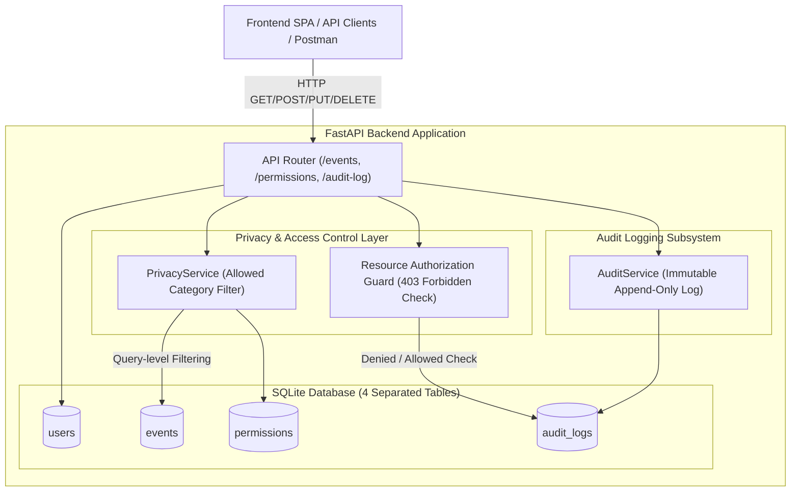

# Chronis • Mini Privacy-Aware Memory Timeline

A robust, privacy-first memory timeline prototype built for the **Chronis SDE Intern Technical Evaluation**. This application ingests and displays chronological user memory events across four core categories (`conversation`, `location`, `physiological`, `note`), allows users to dynamically toggle privacy controls, and **strictly enforces data access boundaries at the backend API layer** with an immutable audit log trail.

---

## Architecture Overview



### Key Architectural Decisions
- **Zero-Friction Turnkey Setup**: Built with **FastAPI** + **SQLite (SQLAlchemy 2.0)** + **Vanilla Modern SPA**. Evaluators can clone, run migrations/seed, execute tests, and launch the entire app without complex database servers or external node daemons.
- **Defense-in-Depth Privacy**: Access control is implemented in the service layer (`PrivacyService` & `EventService`), not merely hidden on the UI.
  - **Collection Listing (`GET /events`)**: Filtered at SQL query level using `WHERE type IN (:allowed_types)`. Restricted categories never enter server memory or network packets.
  - **Direct Resource Access (`GET /events/{id}`)**: Returns `403 Forbidden` if the requested event belongs to a disabled category, immediately recording a `DENIED` entry in `audit_logs`.
- **Read-Only Immutable Audit Log**: Every sensitive action (event creation, deletion, permission toggle, and authorized/blocked access) is recorded with an immutable schema (`timestamp`, `user_id`, `action`, `event_type`, `result`).

---

## Quickstart Guide

### 1. Prerequisites
- Python 3.10+ (Tested on Python 3.12)
- Git

### 2. Setup Virtual Environment & Dependencies
```bash
# Clone the repository
git clone https://github.com/RamanujAgrawal/Mini-Privacy-Aware-Memory-Timeline.git
cd Mini-Privacy-Aware-Memory-Timeline

# Create virtual environment
python -m venv .venv

# Activate virtual environment
# Windows:
.\.venv\Scripts\activate
# macOS/Linux:
source .venv/bin/activate

# Install dependencies
pip install -r backend/requirements.txt
```

### 3. Initialize & Seed Database
```bash
python backend/seed.py
```
*Creates the database tables, configures demo user `Alex River (ID: 1)`, sets all 4 permissions to `ON`, and seeds 8 realistic memory timeline events.*

### 4. Run Automated Test Suite
```bash
pytest backend/tests -v
```
*All 11 automated test cases pass in under 1 second.*

### 5. Launch Application
```bash
python run.py
```
- **Web Timeline UI**: [http://127.0.0.1:8000](http://127.0.0.1:8000)
- **Interactive Swagger Docs**: [http://127.0.0.1:8000/docs](http://127.0.0.1:8000/docs)
- **ReDoc Documentation**: [http://127.0.0.1:8000/redoc](http://127.0.0.1:8000/redoc)

---

## API Documentation

All endpoints are available at root (e.g. `/events`) and versioned prefix (`/api/v1/events`).

| Method | Endpoint | Description | Privacy & Audit Behavior |
| :--- | :--- | :--- | :--- |
| `GET` | `/events` | List events with pagination and filtering | Filters out disabled categories at SQL query level. Supports `?type=`, `?limit=`, `?offset=`. |
| `GET` | `/events/{id}` | Get event by ID | Returns `200 OK` if allowed; returns **`403 Forbidden`** and audits `DENIED` if category is OFF. Returns `404` if not found. |
| `POST` | `/events` | Create new memory event | Validates schema (title, content, category enum). Audits `CREATED`. |
| `DELETE`| `/events/{id}` | Delete event by ID | Deletes event. Audits `DELETED`. |
| `GET` | `/permissions` | Get user category permissions | Returns dictionary of `{conversation, location, physiological, note}` boolean states. |
| `PUT` | `/permissions` | Toggle category permission | Updates category state (`is_enabled: true/false`). Audits `PERMISSION_SET_ON` / `PERMISSION_SET_OFF`. |
| `GET` | `/audit-log` | Read-only audit log entries | Returns immutable paginated audit entries sorted by timestamp descending. |
| `GET` | `/health` | Service health status | Returns service uptime and version. |

---

## Database Schema

Separated into 4 dedicated tables:

1. **`users`**
   - `id` (INTEGER, PK, autoincrement)
   - `name` (VARCHAR)
   - `email` (VARCHAR, Unique)
   - `created_at` (DATETIME UTC)

2. **`events`**
   - `id` (INTEGER, PK, autoincrement)
   - `user_id` (INTEGER, FK -> `users.id`, Index)
   - `timestamp` (DATETIME UTC, Index)
   - `type` (VARCHAR: `conversation`, `location`, `physiological`, `note`, Index)
   - `title` (VARCHAR)
   - `content` (TEXT)

3. **`permissions`**
   - `id` (INTEGER, PK, autoincrement)
   - `user_id` (INTEGER, FK -> `users.id`, Index)
   - `category` (VARCHAR)
   - `is_enabled` (BOOLEAN, default: True)
   - `updated_at` (DATETIME UTC)
   - *Constraint*: `Unique(user_id, category)`

4. **`audit_logs`**
   - `id` (INTEGER, PK, autoincrement)
   - `timestamp` (DATETIME UTC, Index)
   - `user_id` (INTEGER, FK -> `users.id`, Index)
   - `action` (VARCHAR, e.g., `CREATE_EVENT`, `GET_EVENT_DETAIL`, `PERMISSION_SET_OFF`)
   - `event_type` (VARCHAR, optional category name)
   - `result` (VARCHAR, e.g., `ALLOWED`, `DENIED`, `CREATED`, `DELETED`, `UPDATED`)

---

## Automated Test Coverage

The test suite in `backend/tests/` verifies all requirements specified in Section 5 of the evaluation brief:

1. **`test_create_and_fetch_event`**: Creates an event via `POST /events` and verifies `GET /events/{id}` returns all required fields (`id`, `user_id`, `timestamp`, `type`, `title`, `content`).
2. **`test_delete_event`**: Deletes an event and asserts subsequent queries return `404 Not Found`.
3. **`test_event_validation_errors`**: Asserts invalid categories or empty titles return `422 Unprocessable Entity`.
4. **`test_type_filtering`**: Verifies `GET /events?type=conversation` returns exclusively conversation events.
5. **`test_pagination`**: Verifies `limit` and `offset` work correctly, returning non-overlapping pages and correct totals.
6. **`test_enabled_category_is_returned`**: Confirms enabled categories return data as expected.
7. **`test_disabled_category_is_not_returned_by_backend`**: Disables `physiological` category via API; asserts `GET /events` strictly excludes physiological items, and direct `GET /events/{id}` returns `403 Forbidden`.
8. **`test_changing_permission_affects_later_requests`**: Toggles permission `ON -> OFF -> ON` and verifies that later queries dynamically reflect permission state changes immediately.
9. **`test_audit_entries_created_for_important_actions`**: Confirms that creation, deletion, permission changes, and blocked direct accesses (`DENIED`) generate corresponding audit trail entries.
10. **`test_audit_log_is_read_only`**: Confirms that tampering attempts (`POST`, `PUT`, `DELETE` on `/audit-log`) are rejected with `405 Method Not Allowed`.
11. **`test_root_serves_frontend`**: Verifies the UI is served properly at `/`.

---

## Short Engineering Note

### 1. Where is authorization enforced and why?
**Enforcement Point**: Authorization is enforced directly in the backend service layer (`PrivacyService` and `EventService`) immediately before any database query execution and before returning any single event payload.
**Why**: 
- Enforcing access controls only on the frontend is a fatal security flaw because malicious actors or API consumers can bypass UI controls with `curl`, Postman, or script automation.
- By enforcing permissions in the backend query layer, data is filtered at the database level (`WHERE type IN (:allowed_types)`). Restricted records are **never loaded into application memory** or sent over the wire, providing true data confidentiality and defense-in-depth.

### 2. What happens when a user requests data they are not allowed to see?
- **Collection Queries (`GET /events`)**: If a category is toggled OFF, events belonging to that category are omitted from the SQL result set. The response returns only events from enabled categories. If a user explicitly requests a disabled category via `GET /events?type=location`, the API returns an empty list `[]` and logs a filtered access in the audit log.
- **Direct Resource Queries (`GET /events/{id}`)**: If an event exists in the database but belongs to a disabled category, the backend halts execution and returns an **`HTTP 403 Forbidden`** response with a clear message: `"Access to '<category>' events is restricted by your active privacy settings"`.
- **Forensic Audit Entry**: A security audit log entry is immediately recorded with `action: "GET_EVENT_DETAIL"`, `event_type: "<category>"`, and `result: "DENIED"`, providing visibility into unauthorized access attempts.

### 3. What is one weakness that still exists in your implementation?
- **Coarse-Grained All-or-Nothing Permissions**: Permissions currently operate as a binary toggle per category (`ON/OFF`). There is no support for attribute-based access control (ABAC), time-bounded filtering (e.g. "hide physiological data during work hours"), keyword/entity redaction, or temporary revocations.
- **Synchronous Audit Log Commits**: Audit logs are committed synchronously in the same HTTP request lifecycle. Under heavy write loads, writing to an SQLite audit log could create database contention.

### 4. How would you change the system if it grew to 1 million events per user?
1. **Database Indexing & Partitioning**:
   - Partition the `events` table by `user_id` and time intervals (e.g., monthly partitions) in PostgreSQL.
   - Add a composite B-tree index on `(user_id, type, timestamp DESC)` to keep timeline lookups $O(\log N)$ instead of sequential table scans.
2. **Cursor-based Pagination**:
   - Replace offset pagination (`OFFSET n LIMIT m`, which becomes progressively slower as $n$ grows) with cursor-based keyset pagination using event timestamps (`WHERE timestamp < :cursor ORDER BY timestamp DESC LIMIT :limit`).
3. **Caching Layer**:
   - Cache user permission maps in Redis with short TTL and invalidation on `PUT /permissions` to avoid hitting the relational database for every timeline request.
4. **Asynchronous Append-Only Audit Stream**:
   - Decouple audit logging from the request-response loop using an asynchronous message broker (Kafka or Redis Streams) with worker pools batch-inserting into an analytical append-only store (ClickHouse or BigQuery).

### 5. What would you improve with one additional day?
1. **Full Authentication & Multi-Tenancy**:
   - Implement JWT-based authentication (OAuth2 / OIDC with access & refresh tokens) and database Row-Level Security (RLS) policies.
2. **Date-Range & Full-Text Search**:
   - Add date range filtering (`start_date`, `end_date`) and full-text search across conversation transcripts and notes using SQLite FTS5 or PostgreSQL `tsvector`.
3. **Automated Granular Privacy Rules**:
   - Allow users to configure rule-based privacy filters (e.g., "automatically turn off location outside home zip code" or "redact heart rate anomalies over 140 BPM").
4. **Export & Data Portability (GDPR/CCPA)**:
   - Provide a `POST /export` endpoint allowing users to download their permitted memory timeline and audit history in encrypted JSON/CSV format.


