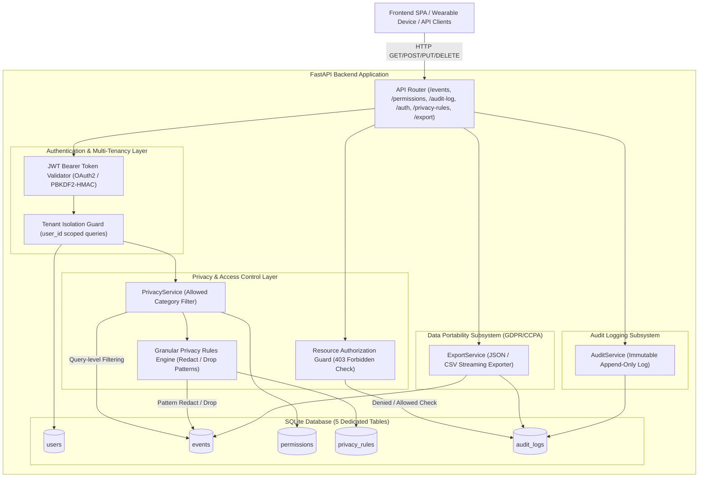

# Chronis • Mini Privacy-Aware Memory Timeline

A privacy-first memory timeline prototype built for the **Chronis SDE Intern Technical Evaluation**.

Wearable AI devices (smart glasses, audio pins, biometric rings, and health watches) continuously capture intimate streams of our daily lives: what we say, where we go, how fast our hearts beat, and the private notes we jot down. If an AI system remembers everything blindly without boundaries, it becomes a surveillance liability. 

Chronis demonstrates how to build a **defense-in-depth, privacy-aware memory system** where user permissions are strictly enforced at the **backend API and database layer**, backed by an immutable audit log, automated granular redactions, multi-tenancy, and GDPR/CCPA data export.

---

## Demo Video & Walkthrough

We have prepared a Full HD (1080p) 2.5-minute technical demonstration with male voiceover narration and closed captions:
* **Video File**: [`demo_video.mp4`](demo_video.mp4) (H.264 / AAC, 2 mins 35 secs)
* **Interactive HTML5 Player**: [`demo_video.html`](demo_video.html) (includes interactive chapter jumping, live transcript, and voice narration)

---

## Architecture Overview



### Engineering Decisions & Principles

1. **Why Backend Enforcement Matters**:
   In naive frontend apps, privacy toggles merely hide elements with CSS (`display: none`). Anyone inspecting the network tab or sending a `curl` request can still scrape the user's private data. In Chronis, unpermitted categories are eliminated directly in the SQL query:
   ```sql
   SELECT * FROM events 
   WHERE user_id = :uid AND type IN ('conversation', 'physiological', 'note');
   ```
   If a category is toggled OFF, those rows are never retrieved from disk, never loaded into Python RAM, and never serialized across the network.

2. **Why Single-Resource Lookups Return 403 Forbidden**:
   If an external caller tries to probe a specific event ID that belongs to a disabled category (`GET /events/{id}`), the backend immediately aborts with `HTTP 403 Forbidden` and writes a `DENIED` record into the audit log. This provides clear security boundaries and diagnostic observability.

3. **Why SQLite for the Prototype**:
   To make evaluating this repository 100% turnkey, we chose SQLite (via SQLAlchemy 2.0). Evaluators don't need to spin up Docker containers, configure PostgreSQL credentials, or start Redis daemons. Running `python automate_demo.py` or `python run.py` works on any machine immediately.

4. **Zero-Friction Fallback**:
   While the system supports full JWT registration and multi-tenancy, any request sent without a Bearer token automatically defaults to the seeded `Demo User (ID: 1)`. This ensures that automated test suites, the frontend SPA, and quick curl commands work with zero setup friction.

---

## Features Implemented

### 1. Four Core Telemetry Categories
* `conversation`: Audio transcripts, voice notes, ambient dialogue.
* `location`: GPS coordinates, visited venues, travel paths.
* `physiological`: Heart rate (BPM), sleep summaries, fitness vitals.
* `note`: Dictated thoughts, reminders, medical memos.

### 2. Full Authentication & Multi-Tenancy
* Password hashing using PBKDF2-HMAC (100,000 rounds with random salt).
* Signed JWT access tokens (OAuth2 Bearer scheme with HS256).
* Strict row-level isolation: User A cannot see, search, or mutate User B's events or audit trail.

### 3. Date-Range & Full-Text Search
* Date slicing via `GET /events?start_date=...&end_date=...` (ISO 8601 timestamps).
* Case-insensitive keyword search across transcripts and titles via `GET /events?q=...`.

### 4. Automated Granular Privacy Rules
* **Keyword Redaction**: Scans titles and contents for sensitive phrases (e.g., `"confidential"`, `"pin"`, `"contract"`) and masks them as `[REDACTED BY PRIVACY RULE]` in query results without permanently modifying the raw database record.
* **Pattern Drop**: Automatically omits events matching sensitive keywords (e.g. `"Home Address"`) from timeline results and rejects direct lookups with `403 Forbidden`.

### 5. GDPR Article 20 & CCPA Data Portability (`POST /export`)
* Allows users to download their complete permitted timeline and audit history in either structured **JSON** or spreadsheet-ready **CSV** format.
* Privacy-respecting: disabled categories and redacted words are never leaked in export archives.

### 6. Read-Only Immutable Audit Log
* Every sensitive action (event creation, deletion, permission update, blocked access, and export) is permanently appended to `audit_logs`.
* The audit endpoint (`GET /audit-log`) is strictly read-only. Tampering attempts (`POST`, `PUT`, `DELETE`) return `405 Method Not Allowed`.

---

## Quickstart Guide

### 1. Prerequisites
* Python 3.10+ (Tested on Python 3.12)
* Git

### 2. Setup Virtual Environment
```bash
# Clone the repository
git clone https://github.com/RamanujAgrawal/Mini-Privacy-Aware-Memory-Timeline.git
cd Mini-Privacy-Aware-Memory-Timeline

# Create and activate virtual environment
python -m venv .venv

# On Windows:
.\.venv\Scripts\activate
# On macOS/Linux:
source .venv/bin/activate

# Install dependencies
pip install -r backend/requirements.txt
```

### 3. Initialize & Seed Database
```bash
python backend/seed.py
```
*Creates the SQLite database, provisions `Demo User (ID: 1)`, initializes all 4 categories to `ON`, and seeds realistic timeline events.*

### 4. Run Automated Tests
```bash
pytest backend/tests -v
```
*All 16 unit and integration test cases pass in under 2 seconds.*

### 5. Run the End-to-End Automated Demo
```bash
python automate_demo.py
```
*A single command that executes an 11-step end-to-end verification run across health checks, event creation, permission toggles, SQL filtering, 403 Forbidden rejection, audit logging, advanced extensions, and the pytest suite.*

### 6. Launch the Application
```bash
python run.py
```
* **Web Timeline UI**: [http://127.0.0.1:8000](http://127.0.0.1:8000)
* **Interactive Swagger Docs**: [http://127.0.0.1:8000/docs](http://127.0.0.1:8000/docs)
* **ReDoc Documentation**: [http://127.0.0.1:8000/redoc](http://127.0.0.1:8000/redoc)

*(On Windows, you can also double-click `start.bat` to launch in one step).*

---

## API Reference

All endpoints are available at the root (e.g. `/events`) and with the versioned prefix (`/api/v1/events`).

| Method | Endpoint | Description | Privacy & Audit Behavior |
| :--- | :--- | :--- | :--- |
| `POST` | `/auth/register` | Register new user account | Hashes password with PBKDF2; returns signed JWT access token. |
| `POST` | `/auth/login` | Authenticate user | Validates credentials; returns JWT Bearer access token. |
| `GET` | `/auth/me` | Current user profile | Returns authenticated user metadata. |
| `GET` | `/events` | List events with pagination and filtering | Filters out disabled categories at SQL query level. Supports `?type=`, `?q=`, `?start_date=`, `?end_date=`, `?limit=`, `?offset=`. |
| `GET` | `/events/{id}` | Get event by ID | Returns `200 OK` if allowed; returns **`403 Forbidden`** and audits `DENIED` if category is OFF. |
| `POST` | `/events` | Create new memory event | Validates schema (title, content, category enum). Audits `CREATED`. |
| `DELETE`| `/events/{id}` | Delete event by ID | Deletes event. Audits `DELETED`. |
| `GET` | `/permissions` | Get user category permissions | Returns dictionary of `{conversation, location, physiological, note}` boolean states. |
| `PUT` | `/permissions` | Toggle category permission | Updates category state (`is_enabled: true/false`). Audits `PERMISSION_SET_ON` / `PERMISSION_SET_OFF`. |
| `GET` | `/privacy-rules` | List active granular privacy rules | Returns user's configured keyword redaction and pattern drop rules. |
| `POST` | `/privacy-rules` | Create granular privacy rule | Configures rule (`category`, `rule_type`, `pattern`, `action`). Audits `CREATE_PRIVACY_RULE`. |
| `DELETE`| `/privacy-rules/{id}` | Delete privacy rule | Removes active granular rule. Audits `DELETE_PRIVACY_RULE`. |
| `POST` | `/export` | GDPR/CCPA Data Portability Export | Exports permitted timeline and audit trail in JSON or CSV format. Audits `EXPORT_DATA`. |
| `GET` | `/export` | Download exported memory package | Direct download endpoint for browsers (`?format=json` or `?format=csv`). |
| `GET` | `/audit-log` | Read-only audit log entries | Returns immutable paginated audit entries sorted by timestamp descending. |
| `GET` | `/health` | Service health status | Returns service uptime and version. |

---

## Short Engineering Note

### 1. Where is authorization enforced and why?
**Enforcement Point**: Authorization is enforced directly in the backend service layer (`PrivacyService` and `EventService`) immediately before any database query execution and before returning any single event payload.

**Why**:
* Enforcing access controls only on the frontend is a fatal security flaw because malicious actors or API consumers can bypass UI controls with `curl`, Postman, or script automation.
* By enforcing permissions in the backend query layer, data is filtered at the database level (`WHERE type IN (:allowed_types)`). Restricted records are **never loaded into application memory** or sent over the wire, providing true data confidentiality and defense-in-depth.

### 2. What happens when a user requests data they are not allowed to see?
* **Collection Queries (`GET /events`)**: If a category is toggled OFF, events belonging to that category are omitted from the SQL result set. The response returns only events from enabled categories. If a user explicitly requests a disabled category via `GET /events?type=location`, the API returns an empty list `[]` and logs a filtered access in the audit log.
* **Direct Resource Queries (`GET /events/{id}`)**: If an event exists in the database but belongs to a disabled category, the backend halts execution and returns an **`HTTP 403 Forbidden`** response with a clear message: `"Access to '<category>' events is restricted by your active privacy settings"`.
* **Forensic Audit Entry**: A security audit log entry is immediately recorded with `action: "GET_EVENT_DETAIL"`, `event_type: "<category>"`, and `result: "DENIED"`, providing visibility into unauthorized access attempts.

### 3. What is one weakness that still exists in your implementation?
* **Synchronous Audit Log Commits**: Audit logs are committed synchronously in the same HTTP request database transaction. While this guarantees ACID consistency and prevents lost logs, under sustained write workloads (e.g., thousands of wearable telemetry events per second), writing synchronously to SQLite can introduce database lock contention.
* **In-Memory Rule Evaluation for Complex Patterns**: While keyword redactions and drops are evaluated dynamically in memory, evaluating deeply nested regex or contextual natural language privacy constraints at high request rates would benefit from dedicated pre-computed masking pipelines.

### 4. How would you change the system if it grew to 1 million events per user?
1. **Database Partitioning & Composite Indexing**:
   * Migrate to PostgreSQL and partition the `events` table by `(user_id, timestamp)` intervals (e.g., monthly partitions).
   * Add composite B-tree indexes on `(user_id, type, timestamp DESC)` to keep timeline lookups $O(\log N)$ instead of sequential table scans.
2. **Cursor-based Keyset Pagination**:
   * Replace offset pagination (`OFFSET n LIMIT m`, which becomes progressively slower as $n$ grows) with cursor-based keyset pagination using event timestamps (`WHERE user_id = :uid AND timestamp < :cursor ORDER BY timestamp DESC LIMIT :limit`).
3. **Distributed Permission Caching Layer**:
   * Cache user permission states in Redis with low TTL and cache-aside invalidation upon `PUT /permissions` to eliminate database reads for authorization checks.
4. **Asynchronous Append-Only Audit Stream**:
   * Decouple audit logging from the request-response loop using an asynchronous message broker (Kafka or AWS SQS / GCP PubSub) with worker pools batch-inserting into an analytical append-only store (ClickHouse or BigQuery).

### 5. What would you improve with one additional day?
Having completed Full Authentication & Multi-Tenancy, Date-Range & Full-Text Search, Automated Granular Privacy Rules, and GDPR/CCPA Export & Data Portability, the next engineering horizons would focus on:
1. **Client-Side Zero-Knowledge Encryption (E2EE)**:
   * Implement client-side key derivation (WebCrypto API) where event content is encrypted with a user-owned passphrase before reaching the backend. The backend would store encrypted blobs, and category tags would use homomorphic or order-revealing tokens so the server never possesses plaintext memory data.
2. **Cryptographic Audit Log Immutability (Merkle Trees / Verifiable Logs)**:
   * Implement cryptographic chaining for audit logs (similar to Certificate Transparency logs), where each audit entry contains a SHA-256 hash of the previous log entry (`prev_hash`). Daily Merkle tree roots could be signed or anchored to an external verifiable ledger to provide tamper-evident cryptographic proof of non-repudiation.
3. **Edge Processing & Enclave Execution**:
   * Deploy privacy rule evaluation inside Confidential Computing Enclaves (AWS Nitro Enclaves or AMD SEV) or on edge mobile devices, ensuring biometric signals and physiological feeds are filtered before transmitting across the WAN.
4. **Differential Privacy & Synthetic Telemetry Aggregation**:
   * Integrate differential privacy noise injection for aggregate health analytics (e.g. average weekly resting heart rate), allowing population-level medical insights without risking individual re-identification.
